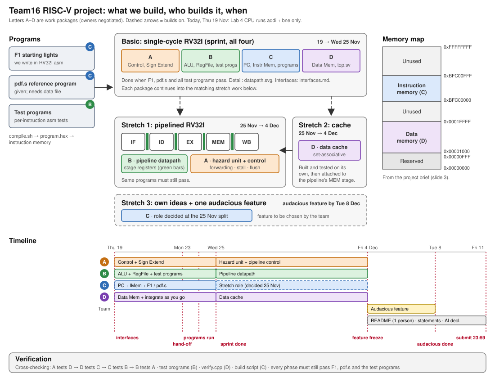
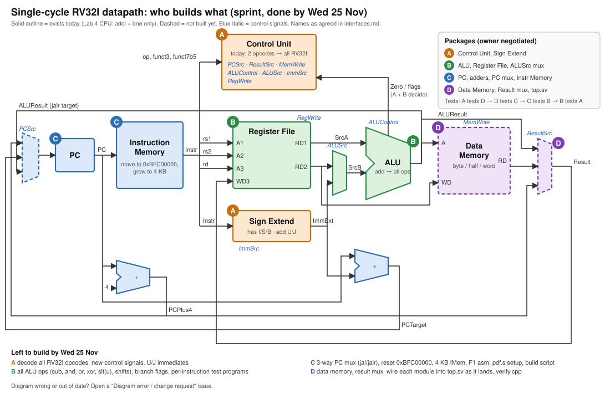

# Team16 project plan

**Deadlines:** team feature freeze **Fri 4 Dec** · audacious feature **Tue 8 Dec** · submission **Fri 11 Dec, 23:59**

Live task board: *link to be added*

---

## Where we are (Thu 19 Nov)

The Lab 4 CPU passes `verify.cpp` but only runs **2 of the ~37 RV32I instructions** (`addi`, `bne`).

| Part | Today | Needed for full RV32I |
|---|---|---|
| ALU | add only | sub, and, or, xor, slt(u), shifts |
| Control unit | 2 opcodes | every opcode, using funct3/funct7 |
| Sign extend | I, S, B | + U, J |
| PC | PC+4 or branch, resets to 0 | + jal/jalr, resets to `0xBFC00000` |
| Instruction memory | 1 KB at address 0 | 4 KB at `0xBFC00000` |
| Data memory | none | byte/half/word loads and stores |
| Write-back | ALU result only | result mux: ALU / memory / PC+4 |

## Where we're going

1. **Basic:** single-cycle RV32I running F1 (our assembly), `pdf.s` and test programs.
2. **Stretch 1:** pipelined CPU with hazard handling.
3. **Stretch 2:** set-associative data cache.
4. **Stretch 3:** our own ideas, including one audacious feature.

---

## How we get there

### Phase 1: sprint, Thu 19 → Wed 25 Nov (complete RV32I in one week)

All four of us finish the single-cycle CPU together, **split by module** so we don't all edit the same files.

| Date | Checkpoint |
|---|---|
| **Thu 19 Nov** (lab session) | Agree module interfaces: [interfaces.md](interfaces.md) |
| **From Fri 20 Nov** | D wires each module into `top.sv` **as soon as it lands** (e.g. R-type first, then loads/stores, then branches/jumps), so integration happens gradually, not in one day |
| **Mon 23 Nov** | Modules finished and handed to the reviewer for unit tests |
| **Tue 24 Nov** | Full CPU runs F1, `pdf.s` and B's per-instruction test programs |
| **Wed 25 Nov** | Fixes, sprint sign-off, move to stretch roles |

### Phase 2: stretch, Wed 25 Nov → Fri 4 Dec

Each package carries on into the stretch work that builds on what it already owns. The pipeline and the cache are built **in parallel**. The cache is developed and tested on its own, then attached to the pipeline.

### Phase 3: finish, Fri 4 → Fri 11 Dec

- **Fri 4 Dec:** feature freeze. All RTL is done, except one audacious feature.
- **Tue 8 Dec:** hard deadline for the audacious feature.
- **All week:** one person owns the README; everyone writes their personal statement; AI Usage Declaration; evidence (waveforms, videos).

---

## Packages

Owners are negotiated within the team.

| Package | Sprint (to 25 Nov) | Stretch (25 Nov → 4 Dec) | Tests the work of |
|---|---|---|---|
| **A** | Control unit + sign extend | Hazard unit + pipeline control | D |
| **B** | ALU + register file + ALUSrc mux, **per-instruction test programs** (one small asm test per RV32I instruction) | Pipeline datapath (stage registers) | A |
| **C** | PC + adders + instruction memory, F1 in assembly, `pdf.s` setup, build script | Decided at the 25 Nov split | B |
| **D** | Data memory + result mux + `top.sv` integration (incremental, from 20 Nov) + `verify.cpp` | Data cache | C |

**Review cycle: A → D → C → B → A** (each person writes the unit tests for the next one's modules). This balances the load: B's ALU work is light, so B takes the heaviest review (A's control unit); D's integration work is heavy, so D gets a lighter review (C's PC and instruction memory).

Where each package sits in the CPU:

---

## Ground rules

- **Interfaces:** [interfaces.md](interfaces.md) is the contract between packages. Change a port only after agreeing it with the people on the other side.
- **Naming:** use the textbook (Harris & Harris) names. Each owner renames the signals in their own files; D fixes `top.sv`.
- **Testing:** nobody signs off their own module. Your reviewer (A→D→C→B→A) writes its unit tests.
- **Done means** that F1, `pdf.s` and all test programs still pass, at every phase.

## Diagram wrong or out of date?

Open a new issue and choose **Diagram error / change request**. It's assigned to Owais.

---

## Still to decide

- C's stretch role (at the 25 Nov split)
- The audacious feature, and who leads it
- Who owns the README in the final week
- Checkpoints between 25 Nov and 4 Dec
- Items marked *decide* in [interfaces.md](interfaces.md), section 3
