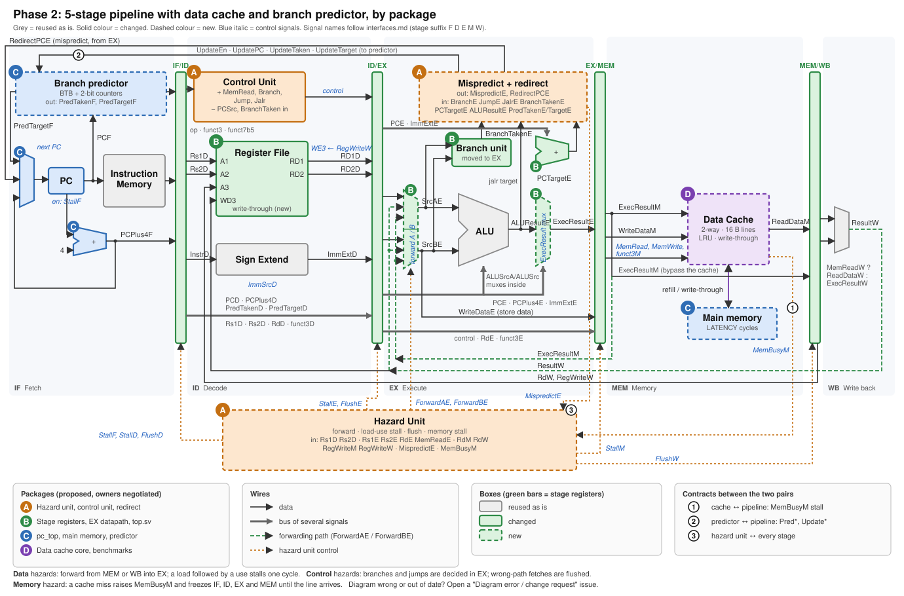
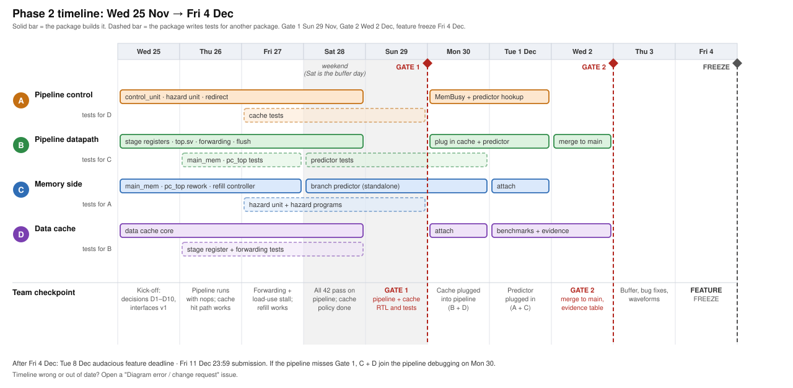

# Team16 Phase 2 plan: pipeline, data cache, branch prediction

**Wed 25 Nov → Wed 2 Dec** · feature freeze **Fri 4 Dec** · audacious feature **Tue 8 Dec** · submission **Fri 11 Dec, 23:59**

Phase 1 plan: [../README.md](../README.md) · Contract between packages: [interfaces.md](interfaces.md)

---

## The goal

By **Wed 2 Dec** the CPU is a **5-stage pipeline with a data cache and a branch predictor**, merged to `main`, with numbers that show each one helps.

| Gate | When | Done means |
|---|---|---|
| **Gate 1** | **Sun 29 Nov** | RTL and tests finished for the **pipeline** and the **cache**, each on its own branch. The pipeline passes all 42 tests. The cache passes its test with a slow memory behind it. |
| **Gate 2** | **Wed 2 Dec** | Pipeline, cache and predictor merged to `main`. All 42 tests pass. The [benchmark table](#evidence-we-will-show) is filled in. |

Thu 3 and Fri 4 Dec are buffer and evidence time before the feature freeze.

## Where we start (Tue 24 Nov)

Single-cycle RV32I is on `main` (PR #19). `verify.cpp` (5 programs) and `top-instructions_tb.cpp` (37 per-instruction tests) all pass. Five things in today's RTL shape the work:

| Today | What it means for Phase 2 |
|---|---|
| `regfile` reads are combinational; a write lands on the clock edge | A write in WB is not seen by a read in ID in the same cycle. Needs write-through (**B**) |
| `branch_unit` compares `RD1`/`RD2` straight after the register read, and `control_unit` takes `BranchTaken` to build `PCSrc` | In a pipeline the branch is decided later, on forwarded values, so `control_unit` can no longer depend on `BranchTaken` (**A**, **B**) |
| `pc_top` holds the PC, the +4 adder, the next-PC mux and the `PCTarget` adder in one module | It has to be split: the PC gets an enable and a 3-way next-PC mux (**C**), and the `PCTarget` adder moves to EX (**B**) |
| `data_mem` answers in the same cycle and has no "not ready" signal | A cache only helps if memory is slower than the cache. We need a slow-memory model and a stall signal (**C**, **D**, **A**) |
| The 42 tests run a fixed 10 000 cycles (1 000 000 for `pdf`) and check only the final `a0` | Extra pipeline cycles will not break them, but they cannot measure speed. We add a benchmark (**D**) |

## Target design: classic 5-stage pipeline

Textbook (Harris & Harris ch. 7) names with a **stage suffix** on every wire: `F D E M W` (`InstrD`, `ALUResultE`, `ReadDataM`, `ResultW`). The exact rule, and the few names that are ours rather than the textbook's, are in [interfaces.md section 8](interfaces.md#8-naming).

| Stage | Does | Reused as is | New or changed |
|---|---|---|---|
| **IF** | fetch, choose next PC | `instr_mem` | `pc_top` rework (enable, 3-way next PC), predictor lookup |
| **ID** | decode, read registers | `sign_ext`, `control_unit`\*, `regfile`\* | regfile write-through |
| **EX** | ALU, branch decision | `alu`, `branch_unit`\* | forwarding muxes, `ExecResult` mux, `PCTargetE` adder (from `pc_top`), mispredict/redirect |
| **MEM** | data access | `data_mem` (kept as the reference model) | `data_cache` + `main_mem` |
| **WB** | write result | `mux` | 2:1 result mux |

\* changed or moved, see [interfaces.md](interfaces.md).

**Three kinds of hazard, three answers**

- **Data:** forward from MEM and WB into EX. A load followed by a user of the loaded value stalls one cycle.
- **Control:** branches and jumps are decided in EX. Instructions fetched down the wrong path are flushed (2 cycles lost per taken branch until the predictor exists).
- **Memory:** a cache miss freezes IF, ID, EX and MEM until the line has arrived.

## Packages (proposed, owners negotiated)

**A + B build the pipeline. C + D build the cache.** C then builds the branch predictor while D plugs the cache in.

| | Wed 25 → Sun 29 | Mon 30 → Wed 2 | Writes the tests for | Diagram |
|---|---|---|---|---|
| **A** pipeline control | `control_unit` changes, `hazard_unit`, mispredict/redirect logic | `MemBusy` and predictor hookup, hazard behaviour under cache misses | **D** (cache) | [package-A.svg](package-A.svg) |
| **B** pipeline datapath | 4 stage registers, pipelined `top.sv`, forwarding and `ExecResult` muxes, `PCTargetE` adder, branch decision in EX, regfile write-through | plug cache and predictor into `top.sv`, merge to `main` | **C** (`main_mem`, `pc_top`, predictor) | [package-B.svg](package-B.svg) |
| **C** memory side, then predictor | `main_mem` slow memory, `pc_top` rework, cache refill controller, then `branch_predictor` | attach predictor with A | **A** (hazard unit, hazard programs) | [package-C.svg](package-C.svg) |
| **D** data cache, benchmarks | `data_cache` core: arrays, hit/miss, LRU, size/sign, write policy | attach cache with B, benchmark harness, evidence table | **B** (stage registers, forwarding) | [package-D.svg](package-D.svg) |

**Who writes whose tests: A → D → B → C → A.** Each pair tests the other pair's work, so every contract between the pairs is exercised by someone who did not write it. Nobody signs off their own module.

## Timeline

| Day | Pipeline pair (A + B) | Cache pair (C + D) |
|---|---|---|
| **Wed 25** | Kick-off: decisions below agreed, `interfaces.md` frozen as v1, branches created. A starts `control_unit` + `hazard_unit`. B starts stage registers + `top.sv`. | C starts `main_mem` (latency parameter) and the `pc_top` rework. D starts cache arrays and hit/miss lookup. |
| **Thu 26** | Pipeline runs hazard-free programs (with `nop`s between dependent instructions). `control_unit` has its new outputs. | Cache hit path works for loads and stores with a zero-latency memory behind it. `pc_top` has its new ports (B writes its tests). |
| **Fri 27** | Forwarding and load-use stall in. R-type, I-type, load and store tests pass **without** `nop`s. | Miss and refill work. `MemBusy` rises on a miss. Passes with `LATENCY` 0 and 6. |
| **Sat 28** | Branch and jump flush plus mispredict logic. **All 42 tests pass on `pipeline`.** Buffer day if not. | Replacement and write policy finished. Stall handshake tested against a stub that holds when `MemBusy`. C starts `branch_predictor` on its own. |
| **Sun 29** | **Gate 1.** Reviews done, `pipeline` ready to receive the cache. | **Gate 1.** Cache test suite green. Predictor compiles with first trace tests. |
| **Mon 30** | **B + D plug the cache into `pipeline`.** 42 tests pass with slow memory and the stall working. | C finishes predictor trace tests. D starts the benchmark harness. |
| **Tue 1 Dec** | **A + C plug the predictor in.** 42 tests and hazard tests pass with the predictor on and off. | Benchmarks run on every configuration. |
| **Wed 2** | **Gate 2.** Merge to `main`, fill the evidence table. | **Gate 2.** |
| **Thu 3, Fri 4** | Buffer, bug fixes, waveforms. **Fri 4: feature freeze.** | |

**If Gate 1 slips for the pipeline,** nothing else starts on top of it: on Mon 30 the cache pair (C + D) joins the pipeline debugging. Gate 1 (Sun 29) is the date everyone works to.

## If capacity runs short

Cut in this order and keep the rest:

1. the predictor `ENTRIES` sweep
2. the `LATENCY` sweeps (keep the default of 6)
3. the 1-entry write buffer (keep stalling on stores)
4. the `5_pdf` triangle benchmark row

**Never cut:** the pipeline passing all 42 tests, the cache passing its test with a slow memory behind it, and a working basic predictor with its trace tests.

## How we test

1. **Regression, must stay green at every merge to `main`.**
   `cd repo/tb && ./doit.sh` runs `tests/verify.cpp` and `tests/top-instructions_tb.cpp` (42 tests). Unit tests: `./doit.sh unit/<name>_tb.cpp`.
2. **Hazard unit and hazard programs (A's work is tested by C).** `hazard_unit_tb` covers the forward selects, load-use, flush, memory stall and the priority order. One small program per case, result in `a0` like the existing tests: `asm/hazard_*.s`, run by `tests/top-hazards_tb.cpp` (the `top-` prefix makes `doit.sh` build it against `top`). Cases:
   back-to-back ALU dependency · dependency two instructions apart · load then use · load then store of the loaded value · ALU then `bne` · load then `bne` · instructions after a taken branch must not commit · `jal` and `jalr` flush · writes to `x0` are never forwarded.
3. **Cache test (D's work is tested by A).** Random and directed loads and stores, all five load sizes and three store sizes, compared against a C++ byte-array model. Sweep `LATENCY` (0, 6, 12) and the cache geometry. Directed pattern: four sequential words must give 1 miss and 3 hits.
4. **`main_mem`, `pc_top` and predictor tests (C's work is tested by B).** `main_mem`: `LATENCY`, line fill, `data.hex` at `0x10000`. `pc_top`: the PC holds when `en` is low, `PCPlus4` is right, and the next-PC priority is redirect, then predicted, then sequential. Predictor, trace-driven: a loop branch taken N times is predicted taken after two; a single not-taken does not flip a strongly taken counter; two branches that map to the same entry.
5. **Stage register and forwarding tests (B's work is tested by D).** Each register holds on enable low and clears to a bubble on clear; forwarding picks the newest value; the regfile returns a same-cycle write.

## Evidence we will show

A benchmark harness (D) reports **cycles until `a0` first holds its final value** for each program. The single-cycle CPU does one instruction per cycle, so its cycle count is also the instruction count, which gives us CPI for free.

| Configuration | `1_addi_bne` | `5_pdf` gaussian | `5_pdf` triangle |
|---|---|---|---|
| Single-cycle (cycles = instructions) | | | |
| Pipeline, zero-latency memory | | | |
| Pipeline, slow memory, no cache | | | |
| Pipeline, slow memory, with cache | | | |
| + branch predictor | | | |

Also record: cache hit rate, mispredict count, and the same table at `LATENCY` 6 and 12.

## Ground rules

- **`main` is always green.** Merge only when `./doit.sh` passes. Until then the pipeline lives on `pipeline`, the cache on `cache`, the predictor on `predictor`. The cache and predictor are built and tested alone, then attached through the ports in [interfaces.md](interfaces.md).
- **Keep the single-cycle CPU safe:** before anything merges, tag it: `git tag single-cycle-v1 420f4cc && git push origin single-cycle-v1` (D).
- **Interfaces:** change a port only after agreeing it with the people on the other side, and update [interfaces.md](interfaces.md) in the same PR.
- **Naming:** Harris & Harris names plus the stage suffix, and the file naming rule, in [interfaces.md section 8](interfaces.md#8-naming).
- **Done means** the 42 tests still pass and the feature has its own tests.
- **Commit small and often.** The final assessment checks commit history as evidence of individual contribution.

## Decide at the kick-off (Wed 25 Nov)

Defaults are in [interfaces.md](interfaces.md) section 7. Anything not objected to by the end of the session stands.

- **D1** Branch decision in **EX** (default) or ID (**A + B**)
- **D2** One `ExecResult` path, so jal, lui and auipc forward (**A + B**)
- **D3** Regfile **write-through** (default) or falling-edge write (**B**)
- **D4** Cache: 2-way, 16-byte lines, 64 sets, LRU, write-through, no-write-allocate (**C + D**)
- **D5** Stores: stall for the memory write (default) or a 1-entry write buffer (**C + D**)
- **D6** `LATENCY` default 6 cycles per line fill (**C + D**)
- **D7** Predictor: 16-entry BTB with 2-bit counters, `jalr` not predicted (**C + A**)
- **D8** The test cycle A → D → B → C → A (**everyone**)
- **D9** Load size and sign handling lives inside the cache, so it matches `data_mem` exactly (**C + D**)
- **D10** `pc_top` rework belongs to C (it owns the module and needs the next-PC mux for the predictor). The `PCTargetE` adder moves to EX with B's datapath (**B + C**)

## Not in this plan

- **Dual-issue superscalar** (the audacious feature) builds on a stable pipeline and predictor, so it is planned separately once Gate 2 is in sight. There is no slack in this plan to start it earlier: doing so means cutting something from the list above first.
- Final-week items (who owns the top-level README, personal statements, AI Usage Declaration) stay in the [main plan](../README.md).

Diagram wrong or out of date? Open an issue and choose **Diagram error / change request**.
