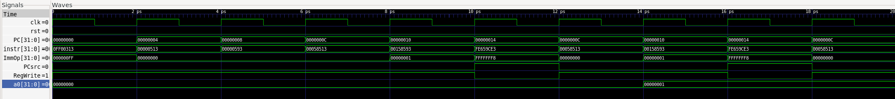
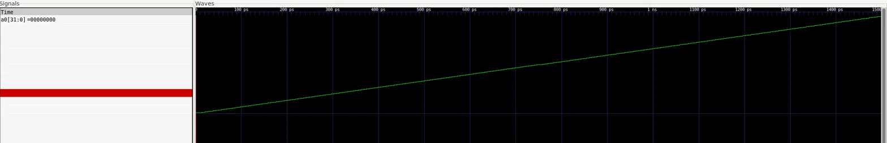

# Test Plan

## How to run
    cd repo/tb
    ./doit.sh                      # all tests
    ./doit.sh tests/alu_tb.cpp     # one test file

Requires Verilator 4.226. Verilator 5.050 aborts on the second test in a file
("The same model has already been added to this trace file").

## Tests
| File | Module | Status |
|---|---|---|
| mux_tb.cpp | mux | passing |
| alu_tb.cpp | alu | passing |
| regfile_tb.cpp | regfile | passing |
| instr_mem_tb.cpp | instr_mem | in review (PR #8) |
| pc_top_tb.cpp | pc_top | in review (PR #8) |
| sign_ext_tb.cpp | sign_ext | in review (PR #8) |
| control_unit_tb.cpp | control_unit | in review (PR #8) |
| verify.cpp | top (whole CPU) | passing |

## Accepted lint warnings (top)
| Warning | Reason |
|---|---|
| PINMISSING funct3, funct7 | Not yet connected in top; fixed in PR #8 |
| UNUSED funct3, funct7 | Not needed to decode addi/bne |
| UNUSED Instr[19:12, 6:0] | Not part of any I/S/B immediate |

## Evidence

First cycles: setup `addi`s (ImmOp = 0xFF), then the inner loop
`0xC → 0x10 → 0x14 → 0xC`. PCsrc is high and ImmOp = 0xFFFFFFF8 (−8) on the `bne`.

`a0` is loaded with the counter `a1` before it is incremented, so it lags `a1` by one.
The inner loop exits when `a1` reaches 255 (`t1`), so the last value written to `a0`
is 254.